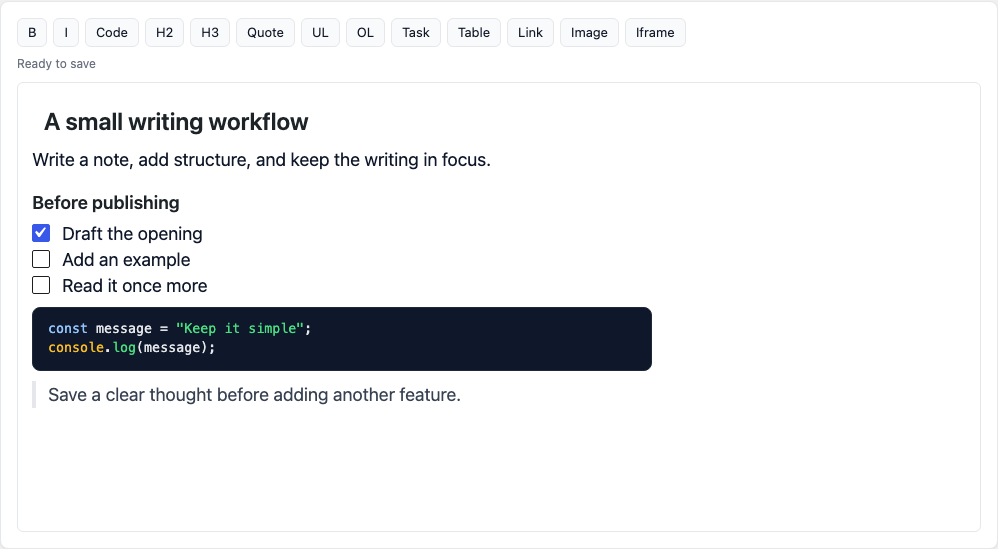

# jazzbb-wp

A personal WordPress editor prototype for writing posts and pages in a focused,
Tiptap-based Markdown surface. It brings the editing approach of
[jazzbb](https://github.com/tloureiro/jazzbb) into the WordPress post form, with
media uploads, a heading outline and a small companion theme.

Markdown is kept alongside rendered HTML, so the frontend can use ordinary
WordPress content rendering. This is a local experiment for trusted authors;
it is not a supported replacement editor for production sites.



## Try it locally

Use a **fresh, disposable site**. Requirements: Node 24, npm, and Docker with
Compose. The tested stack is WordPress 7.1.3 / PHP 8.3 and MySQL 8.4 on Apple
Silicon; see [verification and limits](docs/DEVELOPMENT.md#verification).

```sh
npm ci
npm run check
npm run wp:setup
```

Open `http://localhost:8080/wp-admin/` and log in with `admin` / `admin` on a new
installation. Create a post, enter a title, type or paste Markdown, then Publish
and reload. Drag an image into the editor to upload it to the local media library.
The theme renders the saved HTML with light/dark color schemes.

The demo binds HTTP to loopback and does not publish the database port. These
credentials are only for this local fixture. To choose another port, use
`WP_PORT=18081 npm run wp:setup`; pass the same port to later Compose commands.
Setup preserves existing content and credentials and reports installation or
activation failures. Do not point it at an existing personal site.

## Writing and recovery

- Formatting includes headings, lists/tasks, tables, links, images and code blocks.
  Search lives in the small search control; Enter and Shift+Enter navigate matches.
- Save/Publish stores Markdown in `_jazzbb_markdown` and sanitized HTML in
  `post_content`. Explicit saves use WordPress's revisioned metadata; restoring a
  revision restores the corresponding Markdown and HTML.
- Unsaved Markdown is kept in browser-local storage for the current user/post.
  Reload offers **Restore draft** or **Discard draft**. It does not delete core
  WordPress backups or another post's recovery data. A visible warning reports
  unavailable storage. Recovery is not encrypted; do not use a shared browser
  profile for sensitive drafts. Titles and unsent uploads are not recovered.
- Server autosaves are not a verified Markdown recovery path. Use explicit saves
  and the local recovery prompt. A server autosave's HTML must not be mistaken for
  a matching saved Markdown revision.
- Existing HTML/block posts keep their native editor. There is no automatic
  conversion, custom-post-type support or collaborative/conflict resolution.
- Missing assets keep the native editor available. If JavaScript fails, the native
  content stays visible. Saving an existing Markdown post requires the initialized
  Markdown editor; an incomplete form is rejected to prevent mismatched content.
- Iframe embeds are available for trusted authors (including a YouTube URL helper).
  Embeds contact third-party sites. This has not been reviewed for untrusted
  authors, multisite, accessibility conformance or general production use.

Deactivating the plugin leaves rendered HTML in WordPress; Markdown metadata is
retained. Removing the browser profile clears its local recovery drafts.

## Development

| Command | Purpose |
| --- | --- |
| `npm run check` | Typecheck, offline regression tests, production build |
| `npm run dev:watch` | Rebuild assets while editing |
| `npm run wp:setup` | Start/install local fixture and activate plugin/theme |
| `npm run wp:down` | Stop this Compose stack; retain `.data` |
| `E2E_DISPOSABLE=1 npm run test:e2e` | Full Chromium checks; creates posts/media |
| `npm run hook:install` | Opt into the quick local pre-commit checks |
| `npm audit` | Check current dependency advisories, including build tools |

Build output is ignored under `plugin/build`; build before activating the plugin.
`./run.sh` installs, builds, sets up the fixture and starts a foreground watcher.
Use `SKIP_WATCH=1` to omit the watcher; `RUN_TESTS=1 E2E_DISPOSABLE=1` includes
browser tests. Stop only the stack you started with `npm run wp:down`.

The `.data` directory contains WordPress files, database and uploads. Neither
`wp:down` nor the legacy `wp:destroy` command deletes these bind-mounted files.
Retain them if useful; create a separate disposable checkout for a fresh run.
Do not reuse a database created by the earlier MySQL 8.0 Compose configuration.

Read [development and architecture](docs/DEVELOPMENT.md),
[contribution guidance](CONTRIBUTING.md), and [agent notes](Agents.md) before making
changes. [Unreleased changes](CHANGELOG.md) describe the current work; 0.1.0 is a
source prototype, with no packaged release.

## License

Project source is licensed under **GPL-2.0-or-later**; see [LICENSE](LICENSE).
The companion theme retains its existing [MIT license](theme/nothing-burger/LICENSE).
Third-party components retain their own licenses and attribution; see
[THIRD_PARTY_NOTICES.md](THIRD_PARTY_NOTICES.md).
